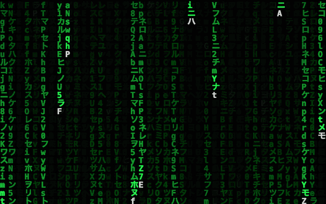
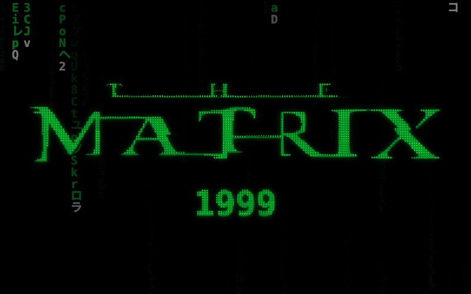
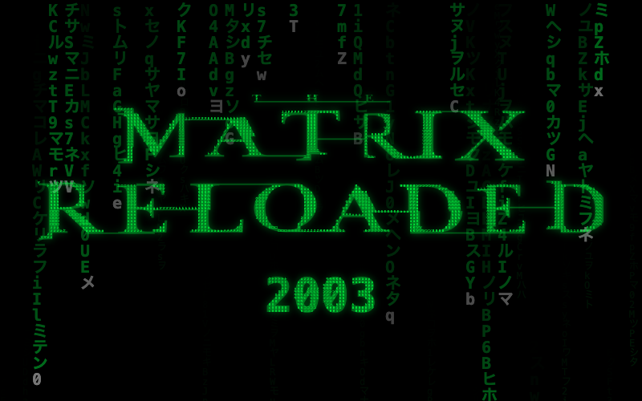
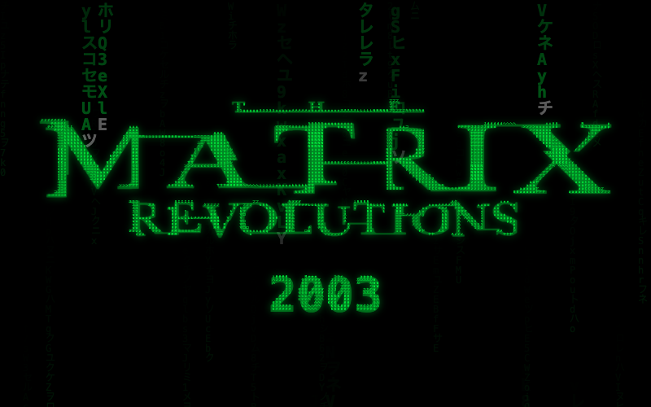

# Matrix Code Rain

This is a little passion project of mine. I'm a big fan of the original Matrix trilogy, and apparently watching green code fall down a screen never gets old.

The idea was to have the rain form each movie's title, hang there for a bit, then fall back into the code. That's what it does now, years included. Characters get caught straight out of the falling streams and settle into the lettering.



## The trilogy

1. **THE MATRIX (1999)**
2. **THE MATRIX RELOADED (2003)**
3. **THE MATRIX REVOLUTIONS (2003)**

<p>
  <a href="./assets/previews/the-matrix.png"></a>
  <a href="./assets/previews/reloaded.png"></a>
  <a href="./assets/previews/revolutions.png"></a>
</p>

Each title gets 15 seconds before the next one takes over. The first film takes its time, Reloaded builds faster, and Revolutions falls away in a slower cascade. The whole thing loops every 45 seconds.

Smaller, slower streams sit in the distance, with a bit of glow and darker rain behind the titles to help the lettering stand out. The GIF is a shorter look at the reveals and releases, captured from the project itself.

## Give it a go

Open [index.html](./index.html) in your browser. That's it. It's plain HTML, CSS and JavaScript, so there's nothing to install or build.

If you'd rather use a local server:

```sh
python3 -m http.server 8765
```

Then open <http://localhost:8765>.

## Controls

| Input | Action |
| --- | --- |
| Space or P | Pause or resume the whole sequence |
| C | Cycle colour schemes |
| Up / + | Increase background rain speed |
| Down / - | Decrease background rain speed |
| R | Restart from THE MATRIX (1999) |
| Left / Right | Previous or next film |
| F | Enter or exit fullscreen |
| Mouse | Move a background rain column |
| ? button | Show controls; Escape closes them |

Move the pointer, tap the screen or use the keyboard to bring up the viewing controls. There's pause/play, previous/next, fullscreen and help. They fade away while you're watching and stay visible while paused or focused with the keyboard.

The speed controls change the free-flowing rain; the title capture keeps its timing. Resizing keeps your place in the trilogy. If your device asks for reduced motion, it starts on a still title. You can browse the films while paused, or press Play when you want it moving. Fullscreen depends on browser support.

## Checking things still work

```sh
node --check script.js
node tests/animation.cjs
```

These cover the animation logic: real stream capture, timing, pause and reset, film navigation, resizing, trilogy order, reduced motion and artwork fallback. Browser checks covered desktop and touch-emulated phone layouts, keyboard controls, help, idle hiding and fullscreen in Chrome, plus opening the page straight from disk.

## A note on the lettering

The title shapes come from sourced film wordmarks. The code uses them as a guide for where the little falling characters should settle, with a faint outline underneath for the finer details. Small details still depend on the screen size and glyph spacing.

Everything needed is stored locally. If the artwork can't load, the titles fall back to ordinary text. [Artwork sources, credits and rights notes are here](./assets/wordmarks/SOURCES.md).
